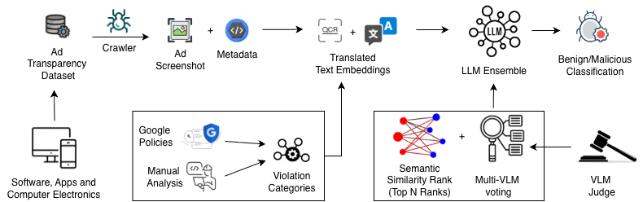

# AdLens: Efficient Detection of Deceptive Software Ads (ACM CCS 2026)

> Code and artifacts for [AdLens](https://racro.github.io/papers/adlens.pdf) (ACM Computers and Communications Security 2026).



**Figure 1:** A high-level diagram illustrating AdLens architecture, including the ad collection and analysis pipelines.

ℹ️ AdLens is a measurement and detection system for malvertising and deceptive ad practices on the **Google Ad Transparency Center**. AdLens crawls ad creatives at scale, extracts text via OCR, and classifies ads into violation categories using an ensemble of vision-language models.

## 📄 Paper
 [AdLens: Efficient Detection of Deceptive Software Ads](https://racro.github.io/papers/adlens.pdf)

> **Erratum — Table 2, section (c):** The Deceptive Claims and Scareware columns were inadvertently transposed in the submission manuscript. The corrected table with full explanation is in [`scripts/README.md`](scripts/README.md#f1_score_table2py).

**Look-forward test-set performance** (full pipeline, macro-averaged over the three violation types; Table 2(c)): **precision 0.993 · recall 1.000 · F1 0.997**. Per-model, per-class breakdown: [`scripts/README.md`](scripts/README.md#f1_score_table2py).

## ⚙️ Paper Artifacts

Supplementary figures, tables, and analyses referenced from the paper's appendix are collected in **[`ARTIFACTS.md`](ARTIFACTS.md)**:

| | Artifact | Cited from |
| --- | --- | --- |
| A | [Google Ads policy violations](ARTIFACTS.md#a-google-ads-policy-violations) (full table) | Background, Deceptive Ad Categories |
| B | [Pipeline latency analysis](ARTIFACTS.md#b-pipeline-latency-analysis) | Methods |
| C | [Misleading ad design examples](ARTIFACTS.md#c-misleading-ad-design-examples) | Results |
| D | [Ads on PDNS-flagged domains](ARTIFACTS.md#d-ads-hosted-by-pdns-flagged-domains) | Landing Page / PDNS |
| E | [Misconfigured ads](ARTIFACTS.md#e-misconfigured-ads) | Appendix |
| F | [Semantic similarity search tool](ARTIFACTS.md#f-semantic-similarity-search-tool) | Methods |

## Requirements

- **Python 3.12** (most stable tested version)
- **Node.js 18+** (crawler only)
- **Ollama** with models pulled locally (detection pipeline)
- **CUDA-capable GPU** (OCR and VLM inference)
- **Google Cloud credentials** (BigQuery queries)

Install Python dependencies. Install `torch` first from the wheel index that matches your NVIDIA driver (pip's default wheel can target a newer CUDA than your driver supports):

```bash
pip install "torch>=2.4,<2.6" --index-url https://download.pytorch.org/whl/cu121   # CUDA 12.x driver; use .../cpu for CPU only
pip install -r requirements.txt
```

Install crawler dependencies:

```bash
cd crawler && npm install
```

## End-to-End Pipeline

### Step 1 — Crawl

Collect ad creatives and screenshots from `adstransparency.google.com` for a given advertiser:

```bash
cd crawler
python run.py <ad-csv-file> --workers 2
```

See [`crawler/README.md`](crawler/README.md) for authenticated crawling and bulk URL input.

### Step 2 — OCR

Extract text from the downloaded screenshots using PaddleOCR PP-OCRv5:

```bash
cd ocr
python process.py \
    --images-dir ../crawler/results/screenshots/worker_0 \
    --output-file ocr.json \
    --device cpu
```

See [`ocr/README.md`](ocr/README.md) for GPU/CPU options and batching flags.

### Step 3 — Translate

Translate non-English OCR text to English using `translategemma:4b` via Ollama. Pass `--out` pointing back at `metadata.json` so the pipeline in Step 4 picks up the translations:

```bash
ollama pull translategemma:4b

python detection/translate_ocr.py \
    --metadata sample_data/metadata.json \
    --out      sample_data/metadata.json
# Reads  : sample_data/metadata.json  (needs ocr_text per record)
# Writes : sample_data/metadata.json  (adds translated_ocr_text in-place)
#          sample_data/cached_translations.json  (dedup translation cache)
```

### Step 4 — Detect

Classify ads with a two-model ensemble (qwen3.5:9b + gemma3:12b) and resolve disagreements with a judge (gemma4:26b).

**Input:** `sample_data/metadata.json` — unlabeled ad records with `ad_id`, `ocr_text` (and `translated_ocr_text` if Step 3 was run); every violation type is run on every record. Images are resolved as `sample_data/images/<ad_id>.png`. For the *labeled* golden set used in the paper's evaluation, add `--eval` (see [Reproducing Table 2](#reproducing-table-2)).

```bash
ollama pull qwen3.5:9b
ollama pull gemma3:12b
ollama pull gemma4:26b

python detection/adlens_pipeline.py
# Output: detection/results/pipeline_results/
#   scareware_results.json
#   misleading_results.json   (deceptive_claim)
#   ad_design_results.json    (misleading_design)
#   classify_cache.json       (resumable)
#   latency_calls.json
```

Run specific violations or cap records for a quick test:

```bash
python detection/adlens_pipeline.py --violations scareware --limit 50
```

### Reproducing Table 2

Table 2 can be recomputed from pipeline output (not just from the hard-coded counts in `scripts/f1_score_table2.py`).

**Table 2(a)/(b) — golden set (1,283 labeled ads).** `--eval` reads `datasets/golden_main_data/metadata.json` (records carry `violation_type` and `label` = `tp`/`tn`) and runs each violation only on the ads labeled for it (449 deceptive-claim / 400 scareware / 434 misleading-design). Images come from `sample_data/images/`.

```bash
python detection/adlens_pipeline.py --eval
python scripts/eval_pipeline_results.py          # prints Tables 2(a), 2(b) and the full-pipeline numbers
```

Full run needs the three Ollama models above (≈1,283 × 2 classifier calls + judge calls on the disagreements; a few hours on a 24 GB GPU). Use `--limit 50` for a smoke test. Classifications are cached, so an interrupted run resumes.

**Table 2(c) — held-out look-forward test set (301 ads).** Images and labels ship in `datasets/golden_test_data/`; see [`datasets/README.md`](datasets/README.md#golden_test_data) for the commands.

## End-to-End Run (single script)

`run_all.py` chains all four stages into a single command and produces a consolidated JSON. Works on a CSV of ads or a single image.

**Before running**, install the parent dependencies and the OCR-specific dependencies (CPU by default):

```bash
pip install -r requirements.txt
pip install -r ocr/requirements.txt
```

> **GPU note:** `ocr/requirements.txt` installs `paddlepaddle` (CPU) by default. For GPU inference, open `ocr/requirements.txt`, comment out `paddlepaddle`, and uncomment the `paddlepaddle-gpu` lines before running the command above. **Do not have both `paddlepaddle` and `paddlepaddle-gpu` installed at the same time — it causes crashes.**

```bash
# Classify a single ad image
python run_all.py --image path/to/ad.png

# Crawl + classify from a CSV
python run_all.py --csv ads.csv --workers 2 --device gpu:0
```

Each stage saves an intermediate file (`ads_after_ocr.json`, `ads_after_translate.json`). Use `--skip-crawl`, `--skip-ocr`, or `--skip-translate` to resume from any stage. Output is written to `run_all_output/ads_final.json` by default (override with `--out-dir`).

The final JSON contains one record per ad with all fields merged: crawler metadata, per-variant OCR text and translation, per-violation classification (per-model, ensemble, judge), and a top-level `malicious` flag.

## Docker

Prebuilt CPU and GPU images are published at [`racro/adlens`](https://hub.docker.com/r/racro/adlens) on Docker Hub. They bundle Python 3.12, Chrome/Puppeteer (crawler), Node.js, Ollama, and all Python dependencies — no local `pip install` / `npm install` needed.

| Tag | Also tagged | Size | Use |
| --- | --- | --- | --- |
| `cpu_v1` | `latest` | ~5.8 GB | CPU-only OCR/inference |
| `gpu_v1` | `gpu` | ~9.4 GB | CUDA GPU OCR/inference (needs `--gpus`) |

```bash
docker pull racro/adlens:cpu_v1   # or racro/adlens:gpu_v1
```

The entrypoint forwards its arguments straight to `run_all.py` (see [Step 4 — Detect](#step-4--detect) / [End-to-End Run](#end-to-end-run-single-script) above), so it takes the same flags:

```bash
docker run --rm racro/adlens:cpu_v1 --help
```

Classify a single local image, mounting data in/out:

```bash
docker run --rm \
    -v "$PWD/sample_data:/app/sample_data:ro" \
    -v "$PWD/run_all_output:/app/run_all_output" \
    racro/adlens:cpu_v1 \
    --image sample_data/images/<ad_id>.png
```

Crawl + classify from a CSV:

```bash
docker run --rm \
    -v "$PWD:/app/host" \
    racro/adlens:cpu_v1 \
    --csv host/ads.csv --workers 2 --out-dir host/run_all_output
```

GPU variant (requires the [NVIDIA Container Toolkit](https://docs.nvidia.com/datacenter/cloud-native/container-toolkit/latest/install-guide.html)):

```bash
docker run --rm --gpus all racro/adlens:gpu_v1 --csv host/ads.csv --device gpu:0
```

**Ollama:** the container expects an Ollama server reachable at `$OLLAMA_URL` (default `http://host.docker.internal:11434` — Ollama running on your host, with the models from [Step 3](#step-3--translate)/[Step 4](#step-4--detect) already pulled). On Linux, `host.docker.internal` needs `docker run --add-host=host.docker.internal:host-gateway ...`. To use the Ollama binary bundled in the image instead, pass `-e OLLAMA_URL=http://localhost:11434`.

### Building the image yourself

[`Dockerfile`](Dockerfile) and [`docker-entrypoint.sh`](docker-entrypoint.sh) reproduce the published images from source:

```bash
docker build --build-arg DEVICE=cpu -t adlens:cpu .
docker build --build-arg DEVICE=gpu -t adlens:gpu .
```

The image is amd64-only (Chrome has no arm64 build); on Apple Silicon / arm64 hosts, Docker Desktop builds and runs it via emulation automatically.

> These were reconstructed from the published images' layer history — the original build files were never committed to this repo — so they reproduce the same contents but aren't guaranteed byte-identical to `racro/adlens:cpu_v1`/`:gpu_v1`.

## Repository Layout

```
.
├── run_all.py        # End-to-end pipeline: crawl → OCR → translate → detect
├── Dockerfile         # Builds the racro/adlens image (see Docker section above)
├── docker-entrypoint.sh
├── crawler/          # Puppeteer crawler for Google Ad Transparency Center
├── detection/        # Ensemble VLM classification pipeline
│   ├── adlens_pipeline.py    # main entry point (steps 3–4)
│   ├── ensemble.py           # classifier prompts + standalone runner; evaluates all three tested models, selects 2
│   ├── misleading_design.py  # CTA/undisclosed-advertiser detection
│   ├── llm_judge.py          # disagreement judge; evaluates three candidate judge models
│   ├── translate_ocr.py      # step 3 — OCR translation
│   └── detect_misconfigured.py  # standalone utility (not part of the pipeline)
├── ocr/              # PaddleOCR text extraction pipeline
├── sample_data/      # Labeled ad dataset (images + metadata)
├── scripts/          # Utility and analysis scripts
│   ├── eval_pipeline_results.py # Table 2 recomputed from adlens_pipeline.py output
│   ├── f1_score_table2.py    # Table 2 from the paper's confusion-matrix counts (no models needed)
│   ├── pdns/                 # Passive DNS lookups for ad landing domains
│   └── plots/                # Paper figure scripts (bar chart, precision bins, dedup)
├── search_platform/  # Gradio semantic search UI
├── sql_queries/      # BigQuery SQL queries and Python client
├── utils/            # Shared Python utilities
└── datasets/         # Golden evaluation sets and confirmed-violation examples
```
